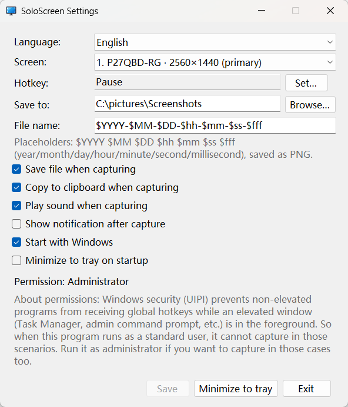

[简体中文](Readme.md) | English

<div align="center">


# SoloScreen

Capture a single monitor with one click — automatically save to a file and copy to the clipboard. Windows only.


</div>

When to use it:

When you need to capture a moment quickly, press the hotkey — SoloScreen automatically saves the file for later organizing and copies it to the clipboard, so you can paste it straight into your chat or social app to share.

## Screenshots



The settings UI is available in Simplified Chinese and English. It follows the system language by default, and you can switch manually at any time.

## Features

- Capture a specific monitor. Useful when you have multiple monitors.
- One-click full-screen capture. No need to set a capture region or confirm a second time.
- Automatically save the PNG file to a directory you choose (you can also disable saving).
- Use your own file name format (down to milliseconds).
- Automatically copy to the clipboard (you can also disable copying).

## Getting Started

First download the latest `SoloScreen.exe` from the [Releases](https://github.com/xuejianxianzun/SoloScreen/releases) page. Then:

1. Run `SoloScreen.exe`. On first run the system may prompt you to install the required runtime. The settings window opens automatically, so you can adjust the options to your needs.
2. Press the hotkey (default `Pause`) to capture the selected monitor.
3. The screenshot is automatically saved to the configured directory and copied to the clipboard — just paste to share.
4. The program stays in the system tray. Right-click the tray icon to open settings or exit.

### More

- Start with Windows; minimize to the tray and stay in the background without occupying the taskbar.
- Runs as a standard user by default. Running as administrator also lets you capture while elevated windows (e.g. Task Manager) are in the foreground.
- Plays a shutter sound on capture by default. You can turn it off or replace it with your own — see [Customize the sound](#customize-the-sound).

## Requirements

Supports Windows 10 (version 1809 or later) and Windows 11. Windows 7 / 8 / 8.1 are not supported.

Built on .NET 10, SoloScreen requires the **.NET Desktop Runtime 10.0** (Windows x64). If it is not installed, the system will prompt you to install it when you run the program.

You can also install it manually: go to the [.NET 10.0 download page](https://dotnet.microsoft.com/download/dotnet/10.0) and download the **Windows x64** installer under ".NET Desktop Runtime".

## File Name Format

Saved file names support the following placeholders (customizable in settings):

| Placeholder | Meaning | Example |
| --- | --- | --- |
| `$YYYY` | Year (4 digits) | 2026 |
| `$MM` | Month | 10 |
| `$DD` | Day | 22 |
| `$hh` | Hour (24-hour) | 19 |
| `$mm` | Minute | 52 |
| `$ss` | Second | 30 |
| `$fff` | Millisecond (3 digits) | 123 |

The default format is `$YYYY-$MM-$DD-$hh-$mm-$ss-$fff`, for example `2026-10-22-19-52-30-123.png`.

## Customize the Sound

SoloScreen has a built-in camera shutter sound. To use your own sound, place an audio file named `audio` (either `.wav` or `.mp3`) in the same directory as the program, then restart the program. Your custom sound will be used instead.

## Build

> Developers only. Regular users can just use the published `SoloScreen.exe`.

Building requires the [.NET 10 SDK](https://dotnet.microsoft.com/download/dotnet/10.0).

```bash
dotnet publish SoloScreen.csproj -c Release -r win-x64 --self-contained false -p:PublishSingleFile=true -o publish
```

The output is a single file `publish/SoloScreen.exe` (requires the .NET Desktop Runtime 10.0). For a portable build that needs no runtime, change `--self-contained false` to `true` (about 49 MB).

## License

Licensed under the [MIT License](LICENSE).
