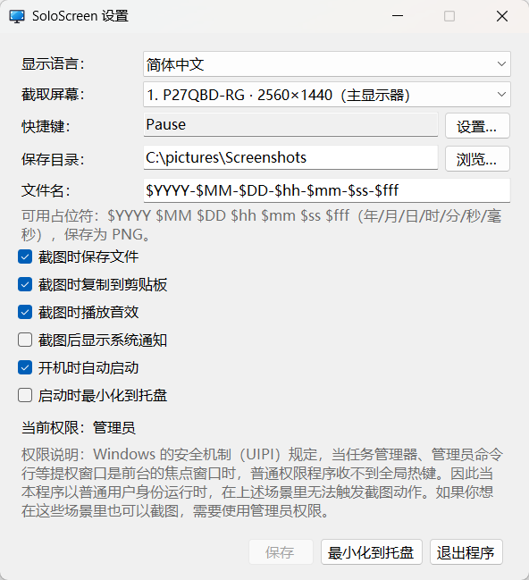

[简体中文](Readme.md) | English

<div align="center">


# SoloScreen

一键截取单个显示器的画面，并且可以自动保存文件、自动复制到剪贴板。仅适用于 Windows 系统。


</div>

适合的使用场景：

在需要抓拍精彩瞬间时按下快捷键，该软件会自动保存文件便于后期整理，并且会自动复制到剪贴板，这样你就可以直接粘贴到社交软件里分享给其他人。

## 界面预览



设置界面支持简体中文和 English，默认跟随系统语言，也可以手动切换。

## 功能介绍

- 只截取指定的显示器。当你有多个显示器时这很有用。
- 一键截取全屏。不需要设置截取范围，也不需要二次确认。
- 自动保存 PNG 文件到你指定的目录（你也可以选择不保存文件）。
- 使用你设置的文件名格式（可以精确到毫秒）。
- 自动复制到剪贴板（你也可以选择不复制到剪贴板）。

## 使用方法

首先从 [Releases](https://github.com/xuejianxianzun/SoloScreen/releases) 页面下载最新的 `SoloScreen.exe`，然后：

1. 运行 `SoloScreen.exe`。首次运行时，系统可能会提示你安装依赖。该软件运行之后会自动打开设置界面，你可以根据自己的需要调整设置。
2. 按下快捷键（默认是 `Pause`）即可截取选中的显示器的画面。
3. 截图会自动保存到指定目录并复制到剪贴板，直接粘贴即可分享。
4. 程序会常驻系统托盘；右键托盘图标可打开设置或退出。

### 其他特性
 
- 支持开机自动启动；可最小化到托盘常驻后台，不占任务栏位置。
- 默认以普通用户权限运行；如果以管理员身份运行，那么在任务管理器等提权窗口处于前台时也能正常触发截图。
- 截图时可以播放提示音，默认是快门音效。你可以关闭音效，也可以替换为自定义音效，见下方[修改音效](#修改音效)。

## 兼容性和依赖

支持 Windows 10（版本 1809 或更高）和 Windows 11；不支持 Windows 7 / 8 / 8.1。

该软件基于 .NET 10 开发，依赖 .NET Desktop Runtime 10.0（Windows x64 版本）。如果你的系统尚未安装该运行库，系统会在运行该软件时提示你安装。

你也可以手动安装依赖：前往 [.NET 10.0 下载页面](https://dotnet.microsoft.com/download/dotnet/10.0)，在「.NET 桌面运行时」部分下载 **Windows x64** 安装包并运行。

## 文件名格式

保存的文件名支持以下占位符（在设置中自定义）：

| 占位符 | 含义 | 示例 |
| --- | --- | --- |
| `$YYYY` | 年（4 位） | 2026 |
| `$MM` | 月 | 10 |
| `$DD` | 日 | 22 |
| `$hh` | 时（24 小时制） | 19 |
| `$mm` | 分 | 52 |
| `$ss` | 秒 | 30 |
| `$fff` | 毫秒（3 位） | 123 |

默认格式为 `$YYYY-$MM-$DD-$hh-$mm-$ss-$fff`，例如 `2026-10-22-19-52-30-123.png`。

## 修改音效

该软件内置了相机快门声的音效。如果你想使用其他音效，请把音效文件放置到该软件的同级目录里，文件名为 `audio`，格式可以是 `.wav` 或 `.mp3`，然后重新运行该软件，这样就可以使用你设置的音效了。

## 构建

> 仅开发者需要。普通用户直接使用发布好的 `SoloScreen.exe` 即可。

构建需要 [.NET 10 SDK](https://dotnet.microsoft.com/download/dotnet/10.0)。

```bash
dotnet publish SoloScreen.csproj -c Release -r win-x64 --self-contained false -p:PublishSingleFile=true -o publish
```

产物为单文件 `publish/SoloScreen.exe`（依赖 .NET Desktop Runtime 10.0）。如需免装运行库的便携版，把命令中的 `--self-contained false` 改为 `true` 即可（体积约 49 MB）。

## 许可证

本项目采用 [MIT License](LICENSE)。
